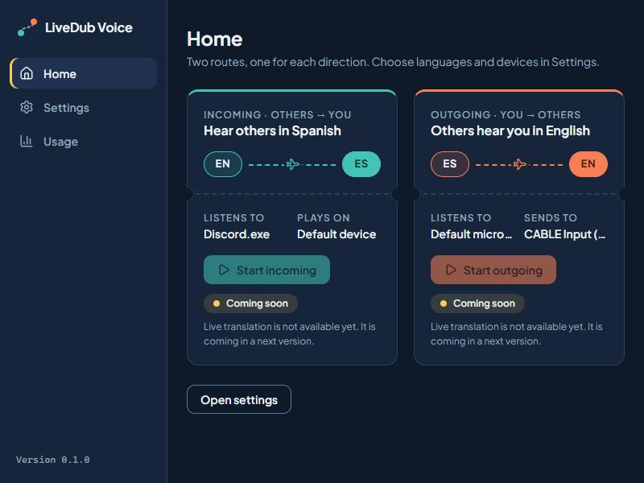
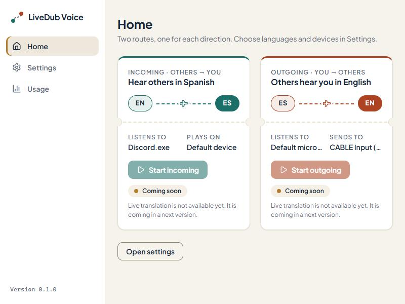
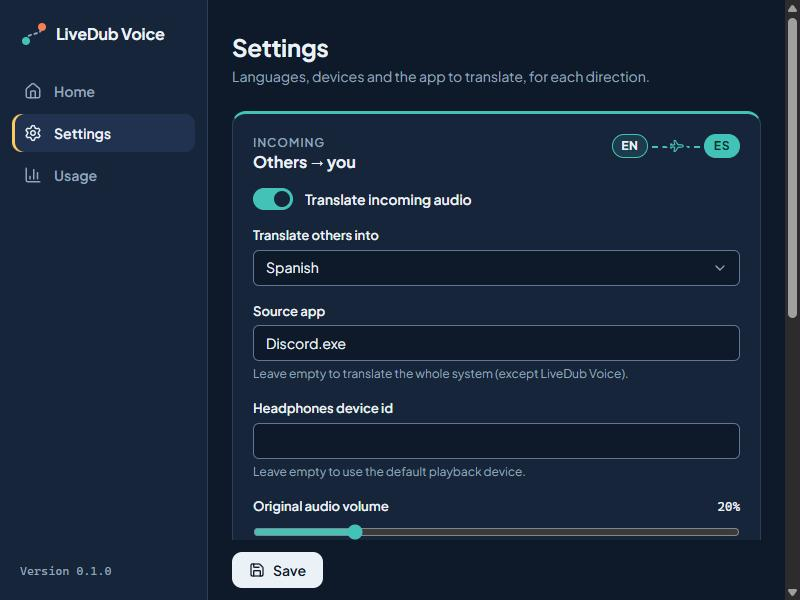
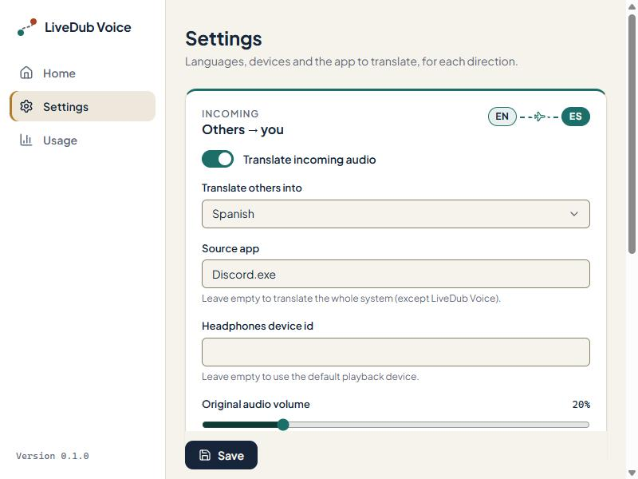

# Ruta — LiveDub Voice design system

Every screen of the LiveDub Voice panel uses the **Ruta** design system. This page explains the idea, the tokens and the components so the app keeps one consistent look as it grows.

| Dark                                        | Light                                         |
| ------------------------------------------- | --------------------------------------------- |
|          |          |
|  |  |

## Concept

LiveDub Voice is about travel between languages. Each translation direction is a **route** between two languages:

- **Incoming** (others → you) is the **teal** route.
- **Outgoing** (you → others) is the **coral** route.

The signature motif is the `LanguageRoute`: two language chips (`EN`, `ES`) joined by a dashed line with a small plane in the middle, in the direction's color. The destination chip is filled ("where you land").

Cards have a subtle **boarding-pass** feel: rounded corners, a hairline border, an optional colored stripe on top for a direction and an optional perforated divider. The overall look is **flat and calm**: no gradients, no glow, minimal shadows. The app runs next to games and calls, so it should never compete for attention.

## Color meanings

Colors carry meaning. Use them for that meaning only, everywhere (buttons, toggles, status, captions, charts).

| Token family       | Meaning                                     | Examples                                         |
| ------------------ | ------------------------------------------- | ------------------------------------------------ |
| `--color-incoming` | Incoming direction (others → you)           | Incoming card stripe, "Start incoming", toggles  |
| `--color-outgoing` | Outgoing direction (you → others)           | Outgoing card stripe, "Start outgoing", toggles  |
| `--color-sun`      | Warnings, highlights, "coming soon"         | Active nav marker, warning notices, focus (dark) |
| `--color-danger`   | Errors and destructive actions              | Error notices, failed status                     |
| `--color-text`     | Neutral actions that belong to no direction | Primary "Save" button                            |

There is no "success green": a success message uses the neutral ink color and a check icon, so green never gets confused with teal (incoming).

## Tokens

All tokens are CSS custom properties in [`src/styles/tokens.css`](../src/styles/tokens.css). The theme follows `prefers-color-scheme`; setting `data-theme="light"` or `data-theme="dark"` on `<html>` forces one (hook for a future theme toggle).

### Colors

| Token                    | Dark      | Light     | Notes                                             |
| ------------------------ | --------- | --------- | ------------------------------------------------- |
| `--color-bg`             | `#0B1A2A` | `#F7F3EC` | App background (light = sand/paper)               |
| `--color-surface`        | `#12263A` | `#FFFFFF` | Cards, sidebar                                    |
| `--color-surface-raised` | `#1A3350` | `#EFE8DB` | Hover, active nav item, toggle track              |
| `--color-border`         | `#24405F` | `#E4DCCD` | Hairlines (decorative only)                       |
| `--color-border-strong`  | `#5B7896` | `#8C7F6A` | Borders of form controls (≥ 3:1 against surfaces) |
| `--color-text`           | `#EAF2F7` | `#12263A` | Body text                                         |
| `--color-text-muted`     | `#8FA6BA` | `#5B6B7A` | Secondary text, hints                             |
| `--color-incoming`       | `#2EC4B6` | `#0A6F67` | Teal                                              |
| `--color-on-incoming`    | `#04342C` | `#FFFFFF` | Text on a teal fill                               |
| `--color-outgoing`       | `#FF7A59` | `#B23F24` | Coral                                             |
| `--color-on-outgoing`    | `#4A1B0C` | `#FFFFFF` | Text on a coral fill                              |
| `--color-sun`            | `#FFC857` | `#B7791F` | Amber, for fills, dots, icons and markers         |
| `--color-sun-text`       | `#FFC857` | `#8C5A00` | Amber when used as text                           |
| `--color-danger`         | `#F25F82` | `#C81E4A` | Errors                                            |
| `--color-focus`          | `#FFC857` | `#0A6F67` | Focus ring                                        |

Each accent also has a `-soft` variant (`--color-incoming-soft`, …): a translucent tint for chip and notice backgrounds.

### Contrast (WCAG AA)

Every text/background pair in use meets AA: 4.5:1 for body text, 3:1 for large text and UI parts. A few shades from the original palette were adjusted to get there:

| Token                    | Original  | Now       | Why                                                                                     |
| ------------------------ | --------- | --------- | --------------------------------------------------------------------------------------- |
| Dark `--color-danger`    | `#EF476F` | `#F25F82` | 4.25:1 on surface → 4.94:1                                                              |
| Light `--color-incoming` | `#0B7A71` | `#0A6F67` | 4.27:1 on surface-raised → 4.95:1 (white on it: 5.20 → 6.03)                            |
| Light `--color-outgoing` | `#C2462A` | `#B23F24` | 4.10:1 on surface-raised → 4.75:1 (white on it: 5.00 → 5.79)                            |
| Light `--color-sun-text` | —         | `#8C5A00` | `#B7791F` is only 3.29–3.64:1 as text; it stays as `--color-sun` for fills, dots, icons |
| `--color-border-strong`  | —         | new       | Hairline borders are ~1.4:1, too faint to outline an input; controls use this instead   |

Key ratios: text on bg 15.5 (dark) / 13.9 (light); muted on surface 6.1 / 5.5; on-incoming on incoming 6.3 / 6.0; on-outgoing on outgoing 5.6 / 5.8. Avoid colored or muted text on `--color-surface-raised` in light mode (muted is exactly 4.5:1 there).

### Typography

- **Font:** Plus Jakarta Sans (variable, OFL-1.1), bundled through `@fontsource-variable/plus-jakarta-sans`. Never load fonts from a CDN: the app must work offline.
- **Numbers, costs and durations:** the monospace stack (`--font-mono`, Cascadia Mono → Consolas) with tabular numbers. Use the `.mono` class.

| Token             | Size | Use                    |
| ----------------- | ---- | ---------------------- |
| `--font-size-xs`  | 12px | Eyebrows, hints, pills |
| `--font-size-sm`  | 13px | Field labels, notices  |
| `--font-size-md`  | 14px | Body (default)         |
| `--font-size-lg`  | 16px | Card titles            |
| `--font-size-xl`  | 20px | Section titles         |
| `--font-size-2xl` | 24px | Screen titles          |

Weights: 400 body, 600 labels and buttons, 700 titles and chips.

### Spacing, radius, motion

- **Spacing:** 4px grid, `--space-1` (4px) to `--space-10` (40px).
- **Radius:** `--radius-sm` 6px (inputs), `--radius-md` 10px (buttons, nav items, notices), `--radius-lg` 14px (cards), `--radius-pill` (chips, pills, toggles).
- **Motion:** `--duration-fast` 120ms, `--duration-normal` 200ms, `--easing-standard`. Only small color/position transitions. With `prefers-reduced-motion: reduce` durations drop to 0.
- **Elevation:** a single `--shadow-sm`. Do not add more.

## Components

Reusable primitives live in [`src/components/`](../src/components). Build new screens from them; add a new primitive there (with its own CSS file) rather than styling a one-off inside a screen.

| Component       | What it is                                                                                     |
| --------------- | ---------------------------------------------------------------------------------------------- |
| `Button`        | Variants `primary` (neutral ink), `secondary`, `ghost`, `incoming`, `outgoing`. Optional icon. |
| `Card`          | Boarding-pass surface. `direction` adds the colored stripe; `eyebrow`, `title`, `aside`.       |
| `Perforation`   | Dashed tear line with notches, to split a card in two parts.                                   |
| `Field`         | Label + control + hint wiring (ids, `aria-describedby`). Base of the inputs below.             |
| `TextField`     | Single-line text input.                                                                        |
| `SecretField`   | Password-style input with a show/hide toggle, for secrets such as the API key.                 |
| `Select`        | Native `<select>` with Ruta styling (keeps native keyboard/screen-reader behavior).            |
| `Slider`        | Range input with its formatted value next to the label; `direction` sets its color.            |
| `Toggle`        | Switch (`role="switch"` checkbox); `direction` sets its "on" color.                            |
| `LanguageRoute` | The route motif: `from`, `to`, `direction`, `size`. Announced as "English to Spanish".         |
| `LevelMeter`    | VU bar on a dB scale (−60 to 0 dBFS) with a peak tick (sun near clipping); `role="meter"`.     |
| `StatusPill`    | Small state label with a dot. Tones `neutral`, `incoming`, `outgoing`, `sun`, `danger`.        |
| `Notice`        | Inline message: `info`, `success`, `warning`, `error` (errors use `role="alert"`).             |
| `PageHeader`    | Screen title and description; the title receives focus after navigation.                       |
| `LogoMark`      | Two stops (teal, coral) joined by a dashed route.                                              |

Icons come from `lucide-react` (ISC), imported one by one so only the icons in use are bundled. Icons next to text are decorative (`aria-hidden`).

## Layout

- App shell: fixed left sidebar (brand, navigation, version) and a scrolling content area, centered up to `--content-max-width`.
- It must fit the minimum window of **800×600**: the two route cards sit side by side on Home and stack on Settings at that size.
- Navigation is React state, no router. The active item has `aria-current="page"` and an amber marker.

## Accessibility

- Every interactive element is reachable by keyboard and shows the focus ring (`--focus-ring`).
- Never convey meaning by color alone: route cards also say "Incoming"/"Outgoing", pills carry a text label.
- Disabled actions explain why next to them (`aria-describedby`), like the "Coming soon" start buttons.

## Language

The panel is translated into **English and Spanish**; the user picks it in Settings → App language (`System` follows the Windows display language).

- Every user-visible string — labels, hints, placeholders, `aria-label`s, empty states, notices, error texts — lives in the dictionaries in [`src/i18n/`](../src/i18n): [`en.ts`](../src/i18n/en.ts) is the source of truth, [`es.ts`](../src/i18n/es.ts) must have the same keys (a missing key fails `tsc` and a test). Add new strings in **both** languages, in the same change.
- Read them with `useT()` (`t("settings.title")`, `{name}` placeholders, `one`/`other` plurals by `count`) or `useI18n()` for `rich()` (React nodes in placeholders) and the `format` helpers. Format numbers, prices (USD) and dates with `format`, never by hand.
- Core errors arrive as `{ code, message }`: give each new code a message under `errors` and show it with `translateError()`; unknown codes fall back to the core's English message.
- Spanish is neutral: no "tú"/"vos" verb forms (prefer infinitives and impersonal phrasing; "tu"/"te" are fine). Product terms (LiveDub Voice, OpenAI, API key, VB-CABLE) stay as they are.
- Leave room for text that grows: Spanish runs ~20–30% longer than English.
- Code, comments, commits and docs stay in English; only the dictionaries hold other languages.

## Do and don't

**Do**

- Use teal for anything incoming and coral for anything outgoing, and nothing else for those colors.
- Use tokens for every color, size, radius and duration.
- Reuse the components; extend them with a prop before writing new CSS in a screen.
- Put every new user-visible string in `src/i18n/en.ts` and `src/i18n/es.ts`.
- Check contrast when you introduce a new text/background pair, in both themes.

**Don't**

- Don't add gradients, glows, heavy shadows or decorative animation.
- Don't hard-code hex values outside `tokens.css`.
- Don't use teal or coral for generic actions (Save, Open settings) — those are neutral.
- Don't load fonts, icons or styles from a CDN, and don't add a UI framework, Tailwind or a CSS-in-JS runtime.
